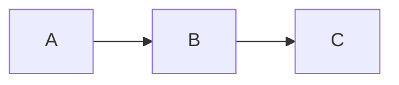

329枚のスライドを
LLMの力で
**<BrandEmoji name="slidev" after-text="Slidev" />** に移行する話

---
heading: 勢い駆動スライド作成
---

::left::

プログラミングサークル (TNP) で、未経験者向けの C++ 講義を作っている
これを <BrandEmoji name="powerpoint" after-text="Microsoft PowerPoint" /> を使い
勢いに任せて **329枚** 作った

::right::


---
heading: PowerPoint はつらい
---

::left::

勢いでやってきたものの、振り返ると

- **手作業**で Syntax Highlighting
  - `Alt + H` → `TH` → `→↓` で
    文字色を指定する技を覚えたりした
- スライドの**コピペを多用**する
  - ものの、どのスライドか探すのつらい
- デザイン**修正の影響範囲**がデカい
  - 1つ直せばもう1つが直ってない

> [!WARNING]
> 内容を書くことだけに集中したいが…

::right::


---
heading: Slidev
cols: 'minmax(0, 3fr) minmax(0, 1.5fr)'
---

::left::

[slidevjs/slidev](https://github.com/slidevjs/slidev)

- markdown でスライドが書ける
- コードのハイライト機能や
- スライド上で動くコードエディタ
```python
print("Hello World!")
```

- 図は Mermaid 対応


- PDF や PNG に書き出せる

::right::


---
heading: Vue の経験がそのまま使える
---

- レイアウトは <BrandEmoji name="vue" after-text="Vue" /> のコンポーネントとして作成する
  - <BrandEmoji name="powerpoint" after-text="PowerPoint" /> のスライドマスターにあたる
  - `props` と `slot` で設計できる
- <BrandEmoji name="storybook" after-text="Storybook" /> でコンポーネントを確認することもできる

> [!IMPORTANT]
> レイアウトやコンポーネントは1か所直せば全ページに波及する

---
heading: 書くのは markdown だけ
subheading: マウス不要でスライドができちゃう
---

::left::

```html [講義スライドの markdown] {*}{maxHeight:'380px'}
​---
page: 124
typeLabel: boolean
​---

<TermIntro reading="しんりち" term="真理値">

2種類の値 `true` か `false` しかとらない型

<template v-slot:sub>

`bool` 型と呼ばれる

</template>
</TermIntro>

​::left::

​```cpp [コード]
int main(void) {
  bool yes = true;
  printf("true = %d", yes);
  bool no = false;
  printf("false = %d", no);
}
​```

​::right::

​```output [出力]
true = 1
false = 0
​```

printf で `"%d"` で表示できるが
数字になってしまう

`true` は `1`、`false` は `0` に変換される
```

::right::


---
layout: section
heading: Slidev に移行する話
---

---
heading: LLM に頼んでみた
---

でも 329 枚を人の手で書くのは時間がかかるので、LLMに頼んでみる
- 「PPT と同じ見た目で書いてね」
  - 4節(約80ページ)ぶんの markdown + HTML + CSS が**約3,500行**吐き出された
- 同じ「用語紹介」のデザインに**3通りの異なる実装**が吐き出された

<!--
デザインのガイドラインが揃わないので
-->

```html
<p class="s13-reading">へん-すう</p>
<h2 class="s13-word">変数</h2>
```

```html
<p class="function-overview__reading-center">かん-すう</p>
<p class="function-overview__term-center">関数</p>
```

```html
<TermIntro reading="しんりち" term="真理値">
```

> [!WARNING]
> これでは、さすがにつらい

---
heading: ルール① 書き方のルール
---

> [!IMPORTANT]
> こういった失敗はルール化しよう

- レイアウト・コンポーネントとデザインの対応を先に決めてみた
  - <BrandEmoji name="powerpoint" after-text="PowerPoint" /> のスライドマスターと似た発想
- 作った対応表だけで変換させた
  - 新しい部品やデザインを作るのは禁止

| デザイン | 書き方 |
|---|---|
| 強調の囲み | `> [!IMPORTANT]` |
| 左右2列 | `::left::` / `::right::` |
| 画像＋キャプション | `` |

---
heading: ルール② 終了条件を用意する
cols: 'minmax(0, 3fr) minmax(0, 2fr)'
---

::left::

> [!IMPORTANT]
> 条件を満たして初めて完成としよう

- テンプレートの Visual Regression Test
  - テンプレートの見本を描画してルールに沿っているかチェック
- スライドの Visual Regression Test
  - 全スライドを画像にして比較
  - 意図的な変更以外にも、意図的でない変更・副作用も拾ってこれて便利

最終的には人間のチェックなのだが
それでもゼロから作るよりずっと楽

::right::


---
heading: ルール③ 1枚だけの修正を禁止する
cols: 'minmax(0, 1fr) minmax(0, 0.8fr)'
---

::left::

> [!IMPORTANT]
> 例外を作らせないようにしよう

- 「この1枚だけ文字が入らないんだよな」
  - LLM は文字を小さくして無理やり入れがち
    → スライドごとに見た目が揺れてしまう！
<br>
- よって、1スライドだけの特別扱いを禁止した
  - はみ出しそうなら `<style>` で余白を減らすなど、対応策を指示すると従ってくれる

::right::

```css [禁止：中身を縮めて詰め込む]
.s18-mermaid-wrap .mermaid {
  /* 無理くり入れようとする LLM */
  transform: scale(0.76);
  transform-origin: top center;
}
.s11-ide-grid { 
  /* 文字サイズを小さくしようとする LLM */
  font-size: 0.82rem; 
}
```

```css [許可：余白や配置を調整する]
.s18-mermaid-wrap svg {
  /* 高さを指定すると、縦横比に合わせて幅も変わる */
  height: 13rem !important;
}
```

---
heading: ルールを付けて変換し直す
---

::left::

```html [前] {*}{maxHeight:'130px'}
<SlideGrid cols="1fr 1fr" gap="1.5rem" align="start" class="h-full">
<div>

<p class="s21-intro-heading">今までしれっと 波かっこ <span class="s21-brace">{</span> <span class="s21-brace">}</span> を使ってきたが<br>これらにはちゃんと意味がある</p>

<div class="s21-mini-code" style="margin-bottom:0.6rem">
  <code><span class="s21-tok-kw">int</span> <span class="s21-tok-fn">main</span>(<span class="s21-tok-kw">void</span>) <span class="s21-brace">{</span></code>
  <code class="s21-tok-dim">...</code>
  <code><span class="s21-brace">}</span></code>
</div>

<div class="s21-mini-code" style="margin-bottom:0.6rem">
  <code><span class="s21-tok-kw">for</span> (<span class="s21-tok-kw">int</span> i=<span class="s21-tok-num">0</span>; i &lt; <span class="s21-tok-num">10</span>; i++) <span class="s21-brace">{</span></code>
  <code class="s21-tok-dim">...</code>
  <code><span class="s21-brace">}</span></code>
</div>

<div class="s21-mini-code">
  <code><span class="s21-tok-kw">if</span> (a &gt; <span class="s21-tok-num">10</span>) <span class="s21-brace">{</span></code>
  <code class="s21-tok-dim">...</code>
  <code><span class="s21-brace">}</span></code>
</div>

</div>
<div style="display:flex;flex-direction:column;gap:0.8rem">


</div>
</SlideGrid>
```


::right::

```md [後] {*}{maxHeight:'130px'}
​::left::

# 今までしれっと 波かっこ `{` `}` を使ってきたが
これらにはちゃんと意味がある

​```cpp {1,3}
int main(void) {
...
}
​```

​```cpp {1,3}
for (int i=0; i < 10; i++) {
...
}
​```

​```cpp {1,3}
if (a > 10) {
...
}
​```

​::right::


```


---
heading: 変換し直した結果
subheading: STAGE 2-1 (1節) の比較
---

| | 前 | 後 |
|---|---:|---:|
| タグ | 1,743 | 197 |
| class | 928 | 19 |
| 専用 CSS | 1,524行 | 6行 |

全節を約2週間で変換できた

> [!IMPORTANT]
> ルールを決めることで、
> LLMが早くクリーンにタスクを終えられるようになった

---
heading: まとめ
---

- **<BrandEmoji name="slidev" after-text="Slidev" /> はいいぞ**
  - スライドを書く作業のほとんどが Markdown で完結する
  - Vue component を使ってリッチなコンテンツを作れる
  - ロマン満載
- **ルールを決めてから LLM に任せる**
  - 使ってよいコンポーネントやレイアウトを先に決める
  - 完了の条件を、画像比較のように機械的に確認可能にする
  - LLM に例外的な扱いを作らせない

---
heading: EOF
---
